# Digital Logic Design — Projects

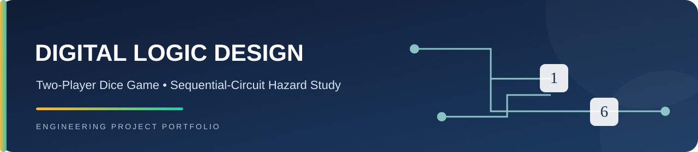

This repository groups two projects completed for the **Logic Design and Digital Systems** course:

1. A practical two-player digital dice game designed in Proteus and documented with hardware-prototype photographs.
2. A research report on hazards in sequential circuits.

## Project 1 — Two-Player Digital Dice Game

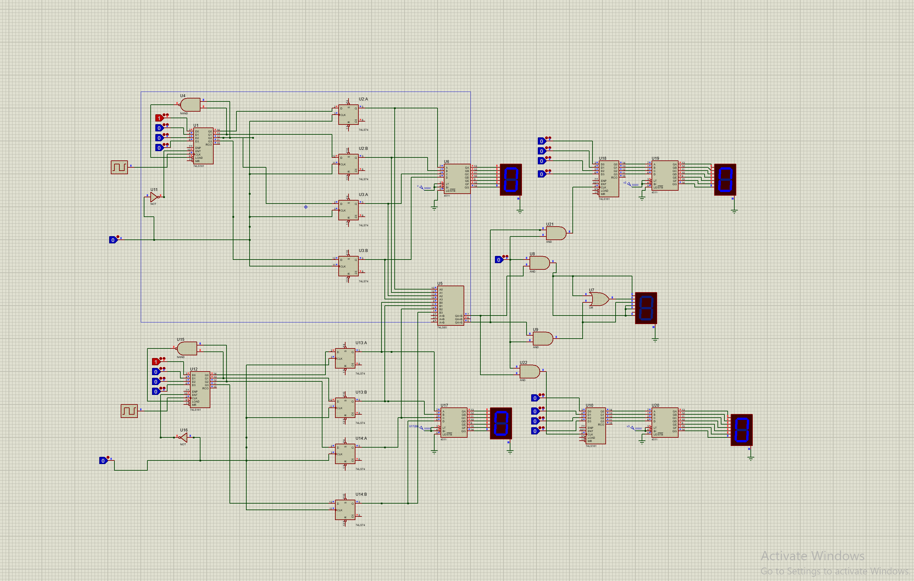

A two-player digital game in which each player presses an independent button to capture a counter-generated value. The submitted report describes a counter-based value generator, D flip-flop storage, BCD-to-7-segment display conversion, winner comparison, and score counting.

### Main building blocks described in the report

- Counter-based number generation, constrained to the dice range.
- D flip-flop to retain a generated value when a player presses the button.
- BCD-to-7-segment conversion and numeric display.
- Comparator logic to determine the round winner.
- Separate score counters for the players.

### Design and prototype images

| Random number display | Winner detection |
|---|---|
| 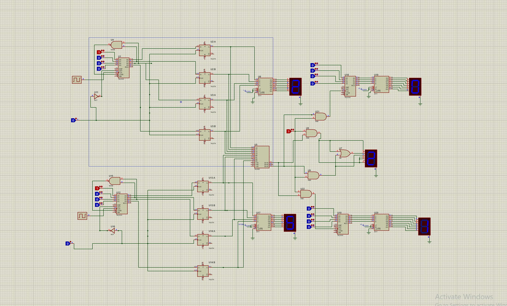 | 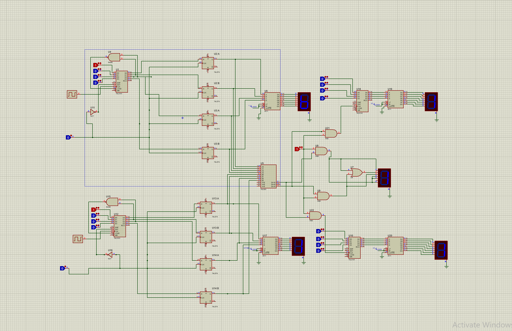 |

| Score counter | Breadboard prototype |
|---|---|
| 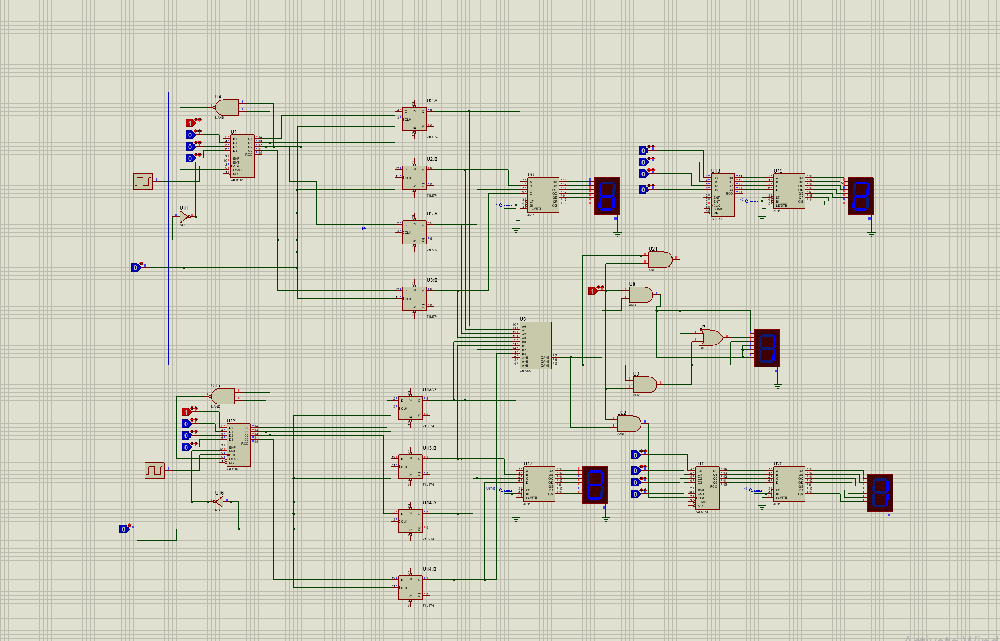 | 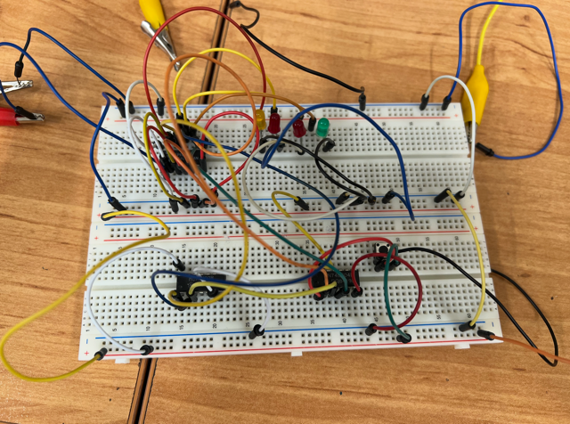 |

Additional prototype view:


[Open the short prototype video](digital-dice-game/assets/digital-dice-prototype-demo.mp4)

### Files

- `digital-dice-game/proteus/Digital_Dice_Game.pdsprj` — Proteus project file.
- `digital-dice-game/docs/Digital_Dice_Game_Report.pdf` — submitted project report.
- `digital-dice-game/assets/` — circuit views, hardware photographs, and a compressed prototype video.

Open the `.pdsprj` file with Proteus Design Suite. Compatibility can depend on the installed Proteus version.

## Project 2 — A Study on Hazards in Sequential Circuits

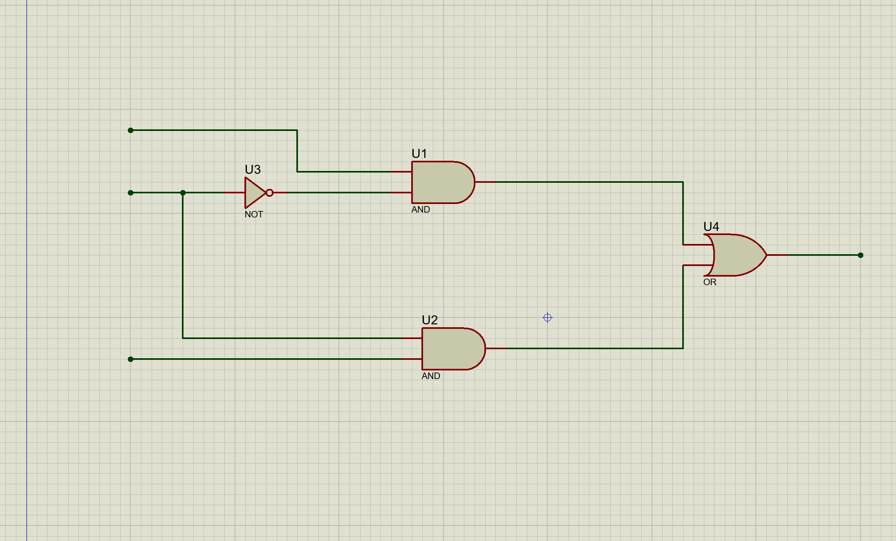

A research project examining unwanted transient behavior (glitches) in level-mode sequential circuits and the impact of propagation delays and input transitions.

### Topics covered in the submitted report

- **Static hazards:** Static-0 and Static-1 behavior.
- **Dynamic hazards:** multiple unwanted transitions while the output changes.
- **Functional hazards:** simultaneous input changes and asynchronous state transitions.
- **Essential hazards:** timing-related problems in asynchronous sequential circuits.

### Mitigation approaches discussed

- Pulsed signals.
- Redundant logic.
- Hazard-free design.
- Balanced propagation delays.
- Edge-triggered design.

### Figures

| Static hazard waveform | Dynamic hazard waveform |
|---|---|
| 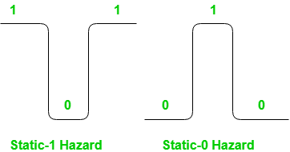 | 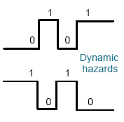 |

| Dynamic hazard block diagram | Hazard-free circuit example |
|---|---|
| 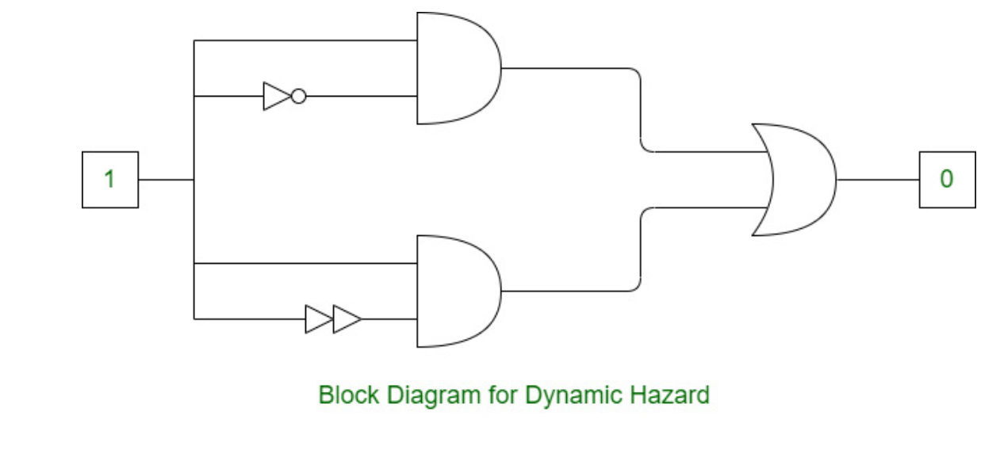 | 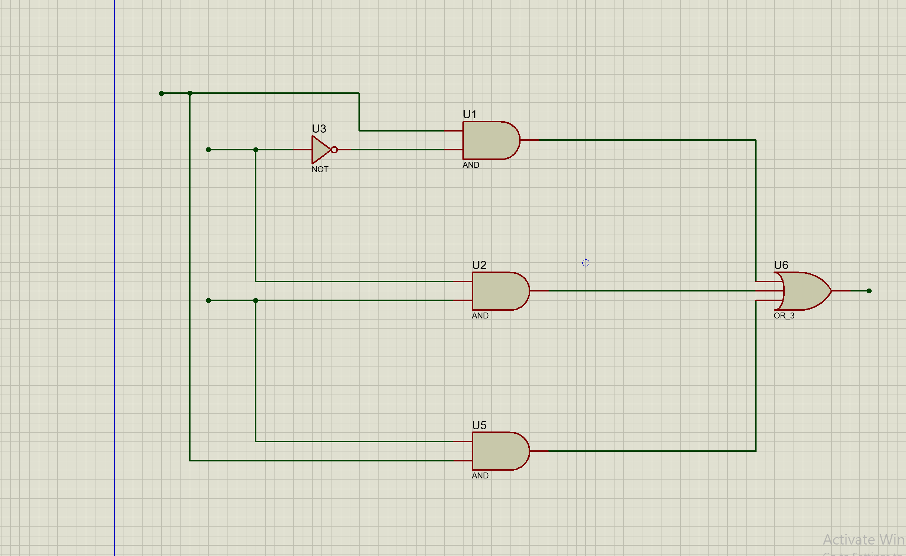 |

### Files

- `hazard-analysis/docs/Sequential_Circuit_Hazard_Study.pdf` — submitted research report.
- `hazard-analysis/assets/` — timing diagrams and circuit figures.

## Repository structure

```text
.
├── assets-banner.svg
├── digital-dice-game/
│   ├── README.md
│   ├── assets/
│   ├── docs/
│   └── proteus/
└── hazard-analysis/
    ├── README.md
    ├── assets/
    └── docs/
```

---
*Course project materials and figures are based on the files supplied with this repository.*
