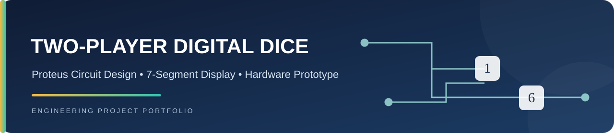
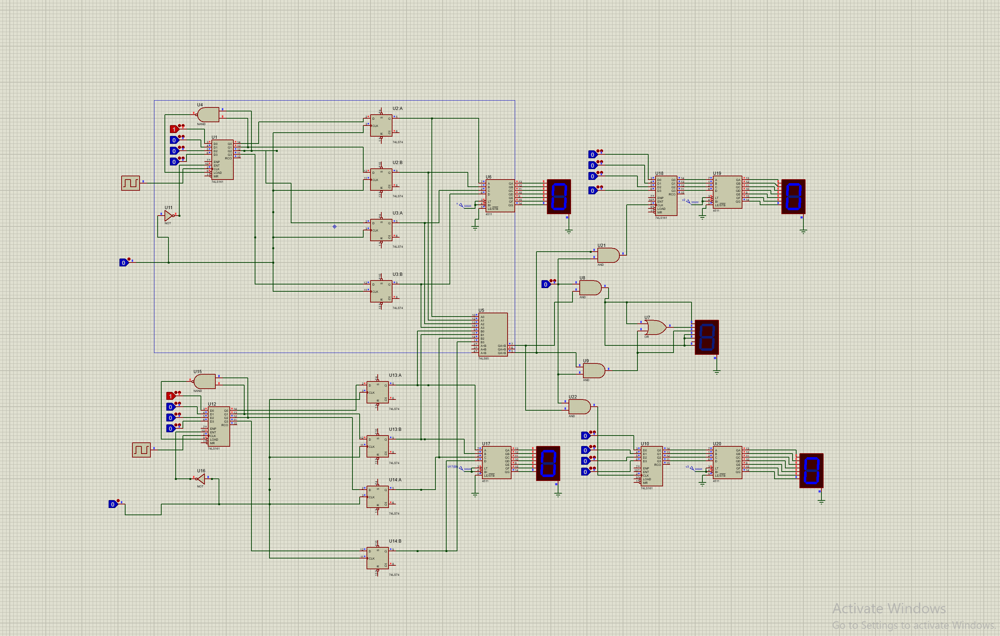
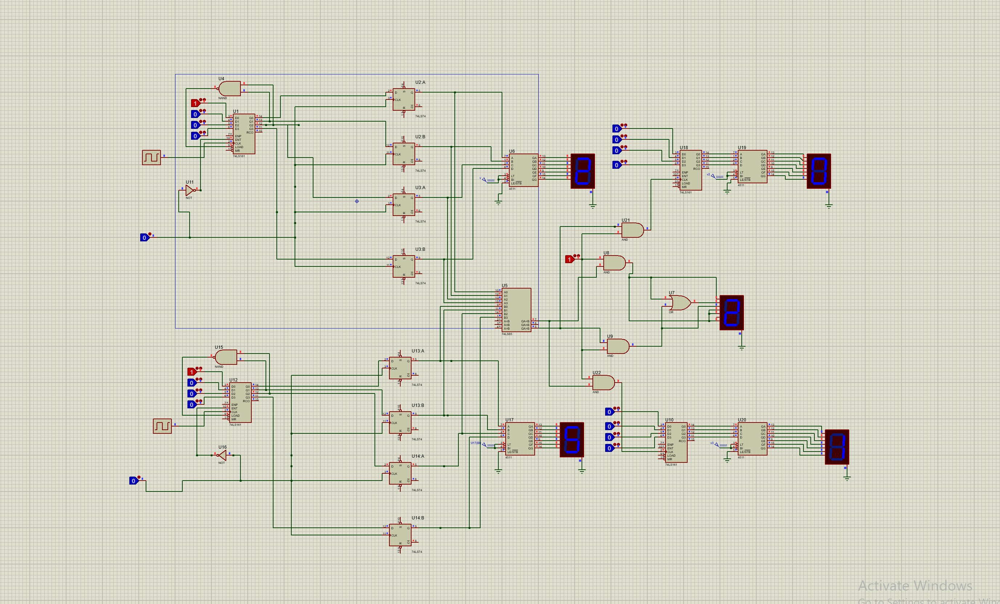
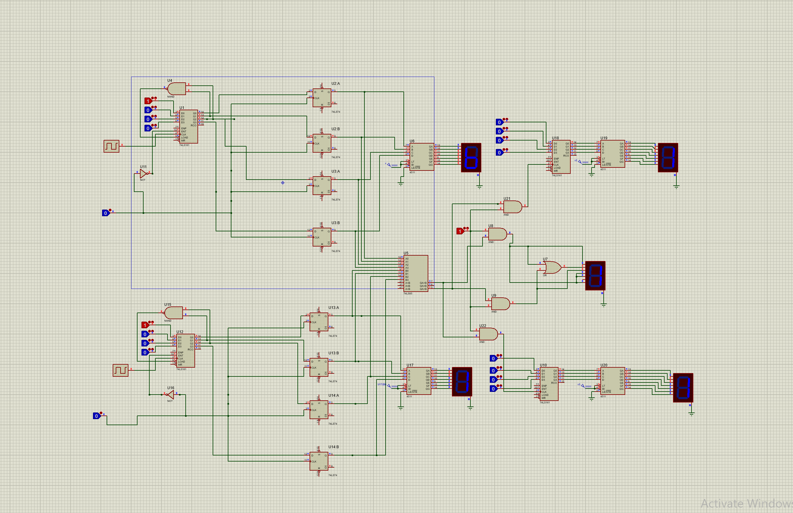
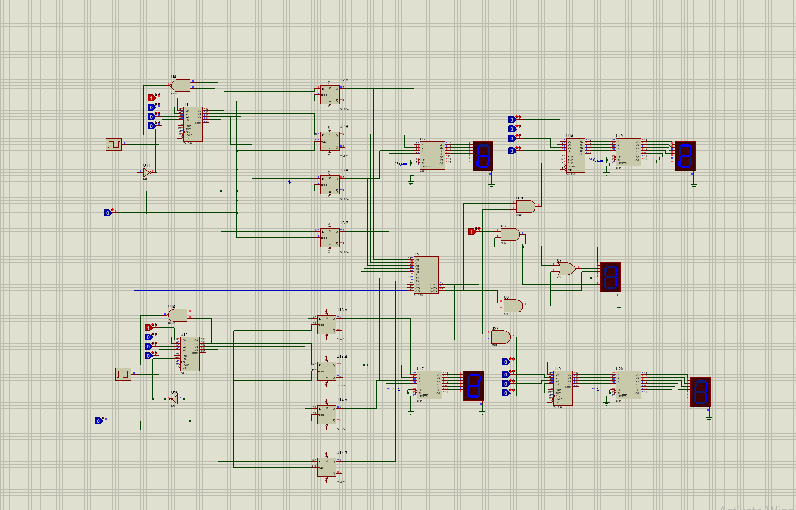
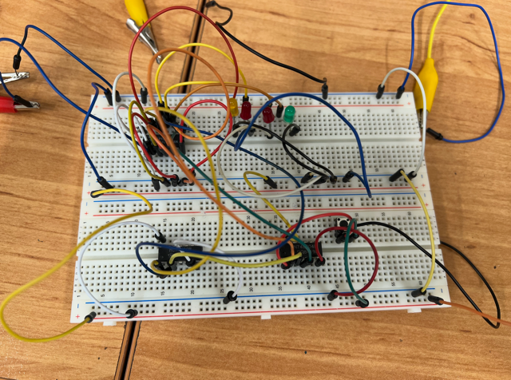

# Two-Player Digital Dice Game

A two-player digital dice game documented as a Proteus circuit design and a physical breadboard prototype.

## How the submitted design works

1. Each player has an independent push button.
2. A counter continuously changes its value to provide the number sampled when the player presses the button.
3. A D flip-flop stores the selected value so it remains displayed.
4. A BCD-to-7-segment stage drives the numeric display.
5. Comparator logic determines which player has the higher value.
6. Score counters record the round result.

The submitted report describes limiting the counter-generated value to the dice range and using reset logic to restart the game.

## Circuit views

| Random number display | Winner detection |
|---|---|
|  |  |

## Hardware prototype

[Watch the prototype video](assets/digital-dice-prototype-demo.mp4)

## Files

- `proteus/Digital_Dice_Game.pdsprj` — Proteus Design Suite project.
- `docs/Digital_Dice_Game_Report.pdf` — submitted report.
- `assets/` — circuit views, prototype photographs, and video.

## Opening the project

Open `proteus/Digital_Dice_Game.pdsprj` in Proteus Design Suite. The project is provided as submitted; compatibility may depend on the installed Proteus version.
