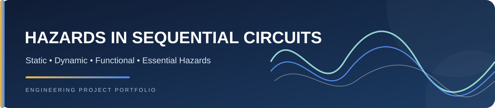
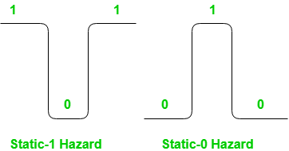
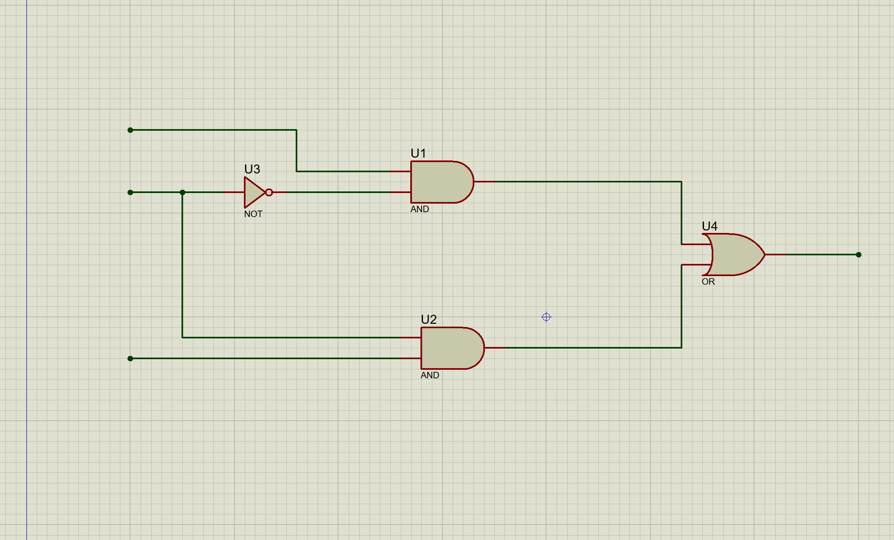
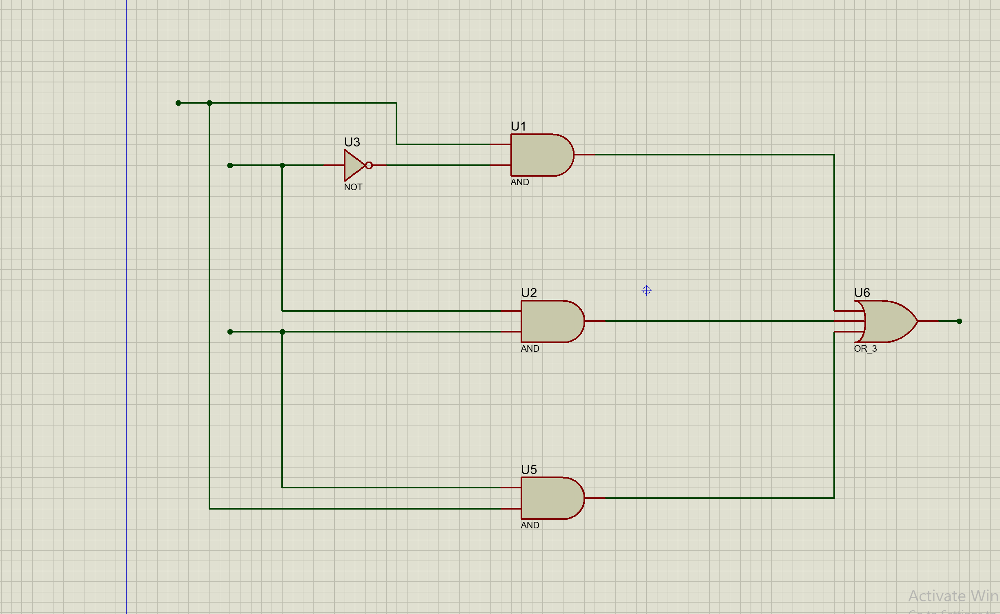
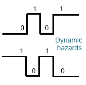
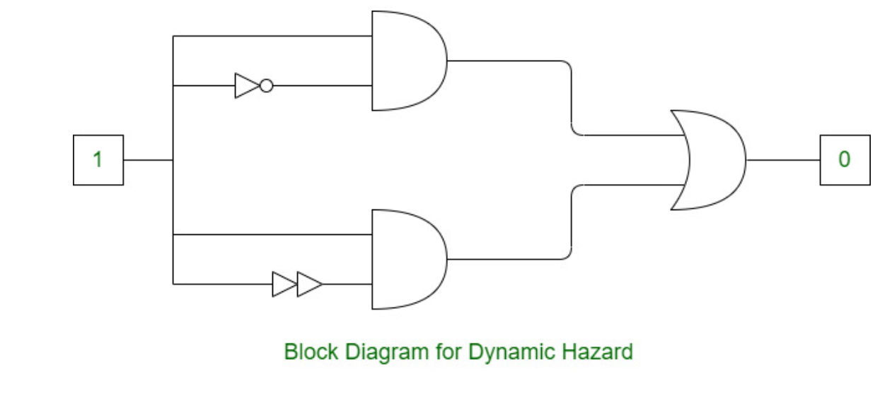

# A Study on Hazards in Sequential Circuits

A research report about hazards in level-mode sequential circuits, focusing on unwanted transient output changes (glitches) caused by propagation delays and asynchronous input changes.

## Topics covered

- **Static hazard:** an output that should remain at a constant logic level briefly changes due to unequal gate delays. The report includes Static-0 and Static-1 examples.
- **Dynamic hazard:** an output makes multiple unwanted transitions while moving from one logic value to another.
- **Functional hazard:** multiple inputs change at nearly the same time and the circuit may pass through an unintended state.
- **Essential hazard:** timing-related behavior in asynchronous sequential circuits.

## Mitigation approaches discussed

The report considers pulsed signals, redundant logic, hazard-free design, balanced delays, and edge-triggered design.

## Figures

### Static hazards

### Dynamic hazards

## Report

See [`docs/Sequential_Circuit_Hazard_Study.pdf`](docs/Sequential_Circuit_Hazard_Study.pdf) for the complete submitted report.
